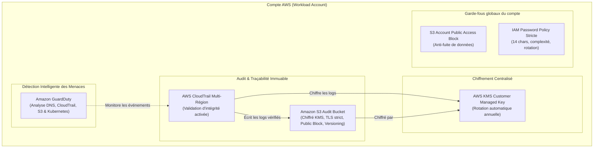

# Projet 1 : Enterprise Security Baseline & Audit Trail (Terraform)

Ce projet déploie la **fondation de sécurité et d'audit** requise dans les environnements cloud d'entreprise et banques/assurances, alignée sur le **CIS AWS Foundations Benchmark v3.0**.

---

## 🏛️ Architecture & Composants



---

## 🔒 Principes de Sécurité implémentés

1. **Immuabilité & Non-Répudiation des Logs** :
   - `enable_log_file_validation = true` : CloudTrail génère un digest cryptographique SHA-256 toutes les heures pour prouver qu'aucun fichier journal n'a été altéré ou supprimé.
2. **Défense en Profondeur du Stockage S3** :
   - Blocage public strict au niveau du bucket ET au niveau du compte (`aws_s3_account_public_access_block`).
   - Rejet immédiat de toute requête non-HTTPS (`aws:SecureTransport = false`).
3. **Chiffrement avec clé gérée client (CMK)** :
   - Utilisation de clés KMS dédiées plutôt que les clés par défaut AWS (`aws/s3`), permettant un contrôle fin via les Key Policies et la rotation automatique des clés tous les 365 jours.
4. **Détection Proactive d'Intrusion** :
   - Amazon GuardDuty utilise du Machine Learning pour repérer les anomalies (ex: appels API suspects depuis un pays inhabituel, désactivation de logs, scan de ports).

---

## 🚀 Déploiement

1. Initialiser le provider :
   ```bash
   terraform init
   ```
2. Vérifier le plan d'exécution :
   ```bash
   terraform plan
   ```
3. Déployer les ressources :
   ```bash
   terraform apply
   ```

