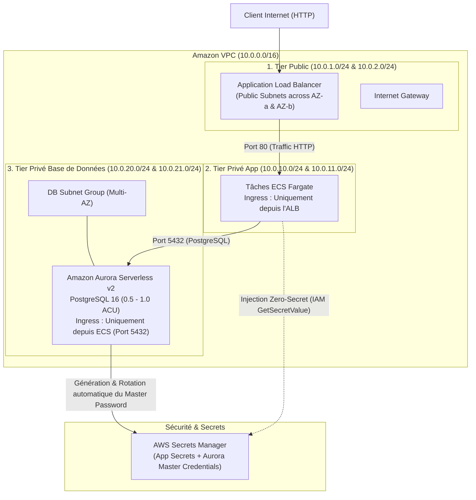

# Projet 2 : Architecture Réseau 3-Tiers, Compute ECS Fargate & Aurora Serverless v2 (Terraform)

Ce projet déploie une infrastructure réseau d'entreprise hautement disponible, un cluster de conteneurs serverless **Amazon ECS Fargate** protégé par un **Application Load Balancer (ALB)**, une base de données **Amazon Aurora Serverless v2 PostgreSQL**, et une gestion Zero-Hardcoded Secrets avec **AWS Secrets Manager**.

---

## 🏛️ Architecture Déployée



---

## 🛡️ Modèle de Sécurité Zero-Trust & Zero-Secret

1. **Security Groups Croisés (Chained SGs)** :
   - **ALB Security Group** : Accepte le port `80` depuis `0.0.0.0/0`.
   - **ECS Security Group** : N'accepte **aucun trafic direct depuis Internet** ; autorise uniquement les flux provenant du Security Group de l'ALB sur le port applicatif (`80`).
   - **Database Security Group** : Autorise uniquement les flux provenant du Security Group des conteneurs ECS sur le port `5432` (PostgreSQL).
2. **Zero-Hardcoded Secrets (AWS Secrets Manager)** :
   - L'argument `manage_master_user_password = true` d'Aurora délègue la création et la rotation du mot de passe maître directement à AWS Secrets Manager. **Aucun mot de passe n'apparaît en clair dans le code Terraform ni dans le fichier `terraform.tfstate`**.
   - Le rôle d'exécution ECS (`ecs_execution_role`) récupère les clés (`DB_HOST`, `DB_USER`, `DB_PASSWORD`, `API_KEY`, `JWT_SECRET`) au démarrage du conteneur et les injecte sous forme de variables d'environnement sans passer par les logs.
3. **Double Rôle IAM ECS (Well-Architected)** :
   - `ecs_execution_role` : Utilisé par l'agent AWS ECS pour télécharger les images Docker et interroger AWS Secrets Manager.
   - `ecs_task_role` : Attribué au code applicatif exécuté dans le conteneur pour ses appels éventuels aux SDK AWS.

---

## 💰 Analyse FinOps & Coûts Réels

* **VPC, Subnets, Route Tables, Internet Gateway, Security Groups** : **0,00 $** (100% gratuit).
* **AWS Secrets Manager** : 0,40 $ / secret / mois (~0,0005 $ pour un test de quelques heures).
* **ECS Fargate (0.25 vCPU, 512 Mo)** : ~0,01 $ / heure.
* **Application Load Balancer (ALB)** : ~0,0225 $ / heure.
* **Amazon Aurora Serverless v2 (0.5 ACU)** : ~0,06 $ / heure lorsqu'il est activé.
* **Mode FinOps par défaut** : La variable `enable_database` est configurée à `false` par défaut afin de maintenir le coût au repos à **0,00 $**. Pour déployer Aurora lors des phases de test ou de validation, passez `-var="enable_database=true"`.

> [!TIP]
> **Règle d'or FinOps** : Dès que vous avez fini de tester votre infrastructure, exécutez `terraform destroy` pour tout supprimer et ne laisser aucune ressource payante active.

---

## 🚀 Commandes de déploiement

1. Initialiser Terraform :
   ```bash
   terraform init
   ```
2. Prévisualiser le plan sans base de données (0,00$ idle) :
   ```bash
   terraform plan
   ```
3. Déployer avec Aurora Serverless v2 PostgreSQL et Secrets Manager :
   ```bash
   terraform apply -var="enable_database=true"
   ```
4. Tester le site web :
   ```bash
   curl -I $(terraform output -raw alb_dns_name)
   ```
5. Nettoyer et détruire les ressources après validation :
   ```bash
   terraform destroy -var="enable_database=true" -auto-approve
   ```
