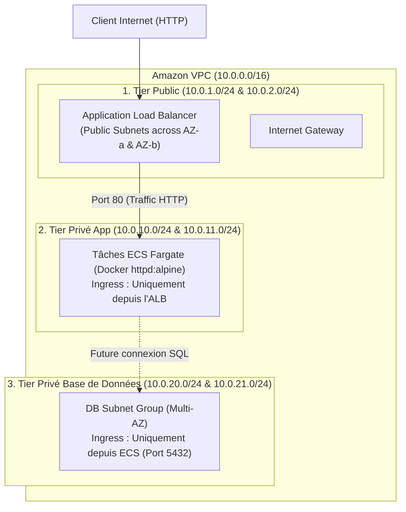

# Projet 2 : Architecture Réseau 3-Tiers & Compute ECS Fargate (Terraform)

Ce projet déploie une infrastructure réseau d'entreprise hautement disponible et un cluster de conteneurs serverless **Amazon ECS Fargate** protégé par un **Application Load Balancer (ALB)**.

---

## 🏛️ Architecture Déployée



---

## 🛡️ Modèle de Sécurité Zero-Trust (Security Groups Croisés)

1. **ALB Security Group** : Accepte le port `80` depuis `0.0.0.0/0`.
2. **ECS Security Group** : N'accepte **aucun trafic direct depuis Internet** ; autorise uniquement les flux provenant du Security Group de l'ALB sur le port applicatif (`80`).
3. **Database Security Group** : Autorise uniquement les flux provenant du Security Group des conteneurs ECS sur le port `5432` (PostgreSQL).

---

## 💰 Analyse FinOps & Coûts Réels

* **VPC, Subnets, Route Tables, Internet Gateway, Security Groups** : **0,00 $** (100% gratuit).
* **ECS Fargate (0.25 vCPU, 512 Mo)** : ~0,01 $ / heure (soit 0,01 € pour 1 heure de test).
* **Application Load Balancer (ALB)** : ~0,0225 $ / heure (soit 0,02 € pour 1 heure de test).
* **NAT Gateway** : **0,00 $** (volontairement non déployé pour économiser 32 $/mois).

> [!TIP]
> **Règle d'or Freelance & FinOps** : Dès que vous avez fini de tester votre application via l'URL de l'ALB, exécutez `terraform destroy` pour tout supprimer et ne laisser aucune ressource payante tourner en continu.

---

## 🚀 Commandes de déploiement

1. Initialiser Terraform :
   ```bash
   terraform init
   ```
2. Prévisualiser le plan :
   ```bash
   terraform plan
   ```
3. Déployer l'infrastructure :
   ```bash
   terraform apply
   ```
4. Tester le site web : Ouvrez l'URL affichée dans la sortie `alb_dns_name`.

