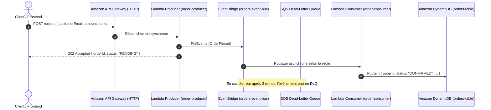

# Projet 3 : Plateforme Serverless Event-Driven avec AWS CDK (TypeScript)

Ce projet implémente une architecture orientée événements (*Event-Driven Architecture - EDA*) entièrement **Serverless**, asynchrone, scalable et à coût **0,00 $ en idle**.

---

## 🏛️ Architecture & Flux Événementiel



---

## 🚀 Fonctionnalités Clés AWS CDK

1. **Paradigme Tout-en-Code (Infrastructure + Handlers)** :
   - Le code d'infrastructure TypeScript et le code applicatif Lambda cohabitent dans le même projet.
   - `NodejsFunction` utilise **esbuild** pour compiler, minifier et packager automatiquement les fichiers TypeScript sans build séparé.
2. **Gestion des Droits par simple méthode (Least-Privilege)** :
   - `eventBus.grantPutEventsTo(producerLambda)`
   - `ordersTable.grantWriteData(consumerLambda)`
   - Génère automatiquement les policies IAM minimales nécessaires.
3. **Tests Unitaires d'Infrastructure avec Jest & `@aws-cdk/assertions`** :
   - Vérifie la conformité de l'architecture avant tout déploiement sur AWS.
4. **FinOps & Graviton** :
   - Runtimes Lambda exécutés sur architecture **ARM_64 Graviton** (20% d'économies).
   - DynamoDB en mode `PAY_PER_REQUEST` (0 requête = 0 centime facturé).

---

## 🛠️ Commandes Principales

```bash
# 1. Lancer les tests unitaires d'infrastructure
npm test

# 2. Synthétiser le template CloudFormation
npx cdk synth

# 3. Comparer avec l'état déployé (équivalent terraform plan)
npx cdk diff

# 4. Bootstrap de la région (requis une seule fois par compte/région pour CDK)
npx cdk bootstrap

# 5. Déployer la stack sur AWS
npx cdk deploy
```
