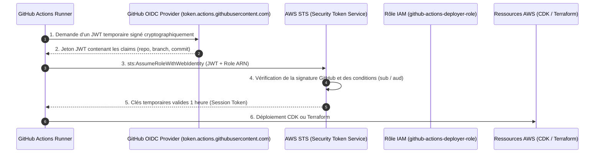

# Projet 4 : Pipeline GitOps & CI/CD Zero-Secret (GitHub Actions & IAM OIDC)

Ce projet implémente le standard de sécurité de l'industrie pour les pipelines de déploiement continu : **l'authentification fédérée OpenID Connect (OIDC)** sans aucune clé d'accès permanente (`AWS_ACCESS_KEY_ID` / `AWS_SECRET_ACCESS_KEY`) stockée dans GitHub.

---

## 🏛️ Séquence d'Authentification OIDC



---

## 🔒 Comparaison de Sécurité : Clés Statiques vs OIDC

| Critère | Clés Statiques dans GitHub Secrets | Fédération IAM OIDC (Ce projet) |
|---|---|---|
| **Stockage des secrets** | Clés secrètes permanentes stockées dans GitHub. Risque de fuite en cas de compromission de compte GitHub. | **ZÉRO secret stocké**. Rien à faire fuiter. |
| **Durée de vie des identifiants** | Infinie (jusqu'à rotation manuelle souvent oubliée). | **Temporaire (15 à 60 minutes max)**, détruite dès la fin du job. |
| **Restriction granulaire** | La clé peut être utilisée depuis n'importe quelle machine sur Internet. | Le rôle ne peut être assumé **que** par votre dépôt et vos branches autorisées. |
| **Audit CloudTrail** | Difficile d'identifier quel commit ou pipeline précis a fait l'action. | CloudTrail enregistre le commit hash, le run ID GitHub et l'auteur précis. |
| **Conformité** | Échoue aux audits SOC2, ISO 27001 et CIS Benchmark. | **Standard recommandé par AWS et GitHub**. |

---

## 🚀 Déploiement du Fournisseur OIDC

1. Initialiser Terraform dans ce dossier :
   ```bash
   terraform init -plugin-dir=../01-landing-zone-terraform/.terraform/providers
   ```
2. Vérifier le plan :
   ```bash
   terraform plan
   ```
3. Déployer l'infrastructure OIDC :
   ```bash
   terraform apply
   ```

Une fois déployé, copiez les fichiers du dossier `.github/workflows/` à la racine de votre dépôt Git pour activer la CI/CD automatique !

