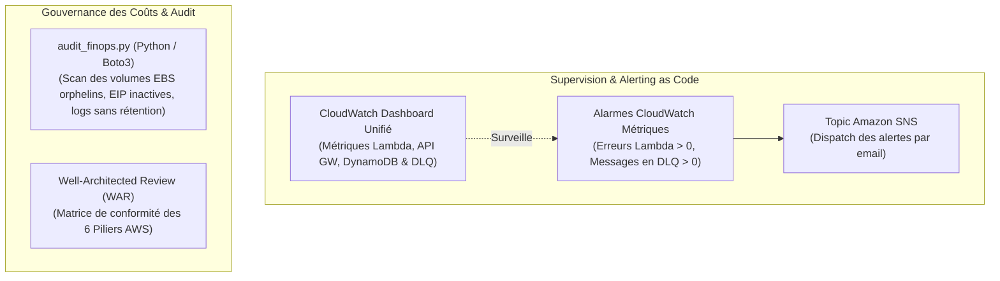

# Projet 5 : Observabilité CloudWatch, Script d'Audit FinOps & Well-Architected Framework

Ce projet constitue l'ultime brique de production : la **supervision unifiée**, **l'alerting automatisé**, **l'audit financier (FinOps)** et la **revue formelle d'architecture (Well-Architected Review)**.

---

## 🏛️ Composants Déployés



---

## 🛠️ Déploiement de l'Observabilité & des Alarmes (Terraform)

1. Initialiser Terraform :
   ```bash
   terraform init -plugin-dir=../01-landing-zone-terraform/.terraform/providers
   ```
2. Déployer le Dashboard et les alarmes :
   ```bash
   terraform apply
   ```
3. L'URL directe pour consulter le tableau de bord CloudWatch dans votre console AWS s'affichera dans les sorties (`dashboard_url`).

---

## 🐍 Exécution du Script d'Audit FinOps

Pour auditer votre compte en local :
```bash
python3 scripts/audit_finops.py
```
Ce script détecte immédiatement :
- Les volumes EBS orphelins non attachés.
- Les adresses IP Élastiques inutilisées facturées par heure.
- Les vieux snapshots de plus de 90 jours.
- Les groupes de logs CloudWatch sans politique de rétention (stockage infini).
- Les buckets S3 sans politique de transition vers Glacier.

