# 🏛️ Architecture Globale de la Plateforme AWS DevOps

Ce document présente l'architecture globale de la plateforme déployée, articulant la gouvernance multi-comptes, la CI/CD Zero-Secret, la sécurité CIS Benchmark, le réseau 3-tiers, le Serverless événementiel et l'observabilité unifiée.

---

## 🗺️ Schéma d'Architecture Global (Vue Unifiée)

```mermaid
flowchart TD
    %% EXTERNAL ACTORS
    Dev["DevOps Engineer (Local)"]
    GHRunner["GitHub Actions Runner (CI/CD)"]
    WebClient["Client Web / API"]
    AdminEmail["Administrateur (Email Alertes)"]

    %% GITHUB OIDC AUTH
    subgraph GitOpsFederation["04. Federation GitOps Zero-Secret"]
        GHOIDC["GitHub OIDC Provider (token.actions.githubusercontent.com)"]
        AWSSTS["AWS STS (AssumeRoleWithWebIdentity)"]
        DeployerRole["Role IAM Deploiement (github-actions-deployer-role)"]
    end

    %% AWS ENVIRONMENT
    subgraph AWSOrg["AWS Organizations"]
        
        %% MANAGEMENT ACCOUNT
        subgraph MgmtAccount["Compte Maitre Management"]
            RootOU["Organisation Root"]
            SCPs["Service Control Policies SCPs (FullAWSAccess)"]
            RootOU --- SCPs
        end

        %% WORKLOAD ACCOUNT
        subgraph WorkloadAccount["Compte Workload (Region Paris eu-west-3)"]
            
            %% FINOPS GUARDRAIL
            subgraph FinOpsGuardrail["00. Garde-Fou FinOps"]
                Budget["AWS Budgets (Plafond 5.00 USD/mois)"]
            end

            %% SECURITY BASELINE
            subgraph SecBaseline["01. Security Baseline (CIS Benchmark)"]
                S3PublicBlock["S3 Account Public Access Block"]
                IAMPolicy["IAM Password Policy (14 chars)"]
                CloudTrail["AWS CloudTrail Multi-Region (SHA-256)"]
                S3Audit["Bucket S3 Logs (Chiffre AES256, TLS Strict)"]
                GuardDuty["Amazon GuardDuty (Detecteur IA)"]
                
                CloudTrail --> S3Audit
                GuardDuty -. Analyse .-> CloudTrail
            end

            %% PROJECT 2: 3-TIER NETWORK & ECS FARGATE
            subgraph VPCNet["02. Reseau 3-Tiers et Compute ECS (VPC 10.0.0.0/16)"]
                IGW["Internet Gateway (dev-igw)"]
                
                subgraph TierPublic["Tier 1 : Public (Subnets Multi-AZ)"]
                    ALB["Application Load Balancer (dev-app-alb Port 80)"]
                    ALBSG["SG: dev-alb-sg (0.0.0.0/0)"]
                end

                subgraph TierApp["Tier 2 : Prive Applicatif"]
                    Fargate["Amazon ECS Fargate (dev-ecs-cluster)"]
                    ECSSG["SG: dev-ecs-tasks-sg (Depuis ALB uniquement)"]
                end

                subgraph TierDB["Tier 3 : Prive Donnees"]
                    DBSubnets["DB Subnet Group Multi-AZ"]
                    DBSG["SG: dev-database-sg (Port 5432 depuis ECS)"]
                end

                IGW --> ALB
                ALB -->|"Trafic HTTP Relaye"| Fargate
                Fargate -.->|"Requetes SQL"| DBSubnets
            end

            %% PROJECT 3: SERVERLESS EVENT-DRIVEN
            subgraph ServerlessEDA["03. Architecture Serverless Evenementielle (AWS CDK)"]
                APIGW["Amazon API Gateway HTTP (POST /orders)"]
                LambdaProducer["Lambda Ingestion Producer (ARM64 Graviton)"]
                EventBus["Amazon EventBridge (orders-event-bus)"]
                EventRule["Regle de Filtrage (detail-type: OrderPlaced)"]
                SQSDLQ["Amazon SQS (orders-processing-dlq DLQ)"]
                LambdaConsumer["Lambda Worker Consumer (ARM64 Graviton)"]
                DynamoDB[("Amazon DynamoDB orders-table")]

                APIGW -->|"Invocation Synchrone"| LambdaProducer
                LambdaProducer -->|"PutEvents"| EventBus
                EventBus -->|"Routage"| EventRule
                EventRule -->|"Evenement Valide"| LambdaConsumer
                EventRule -.->|"Echecs apres retries"| SQSDLQ
                LambdaConsumer -->|"PutItem CONFIRMED"| DynamoDB
            end

            %% PROJECT 5: OBSERVABILITY & FINOPS
            subgraph Observability["05. Observabilite et Alerting (CloudWatch)"]
                CWLogs["CloudWatch Logs (/ecs/dev-app et /aws/lambda/*)"]
                CWDashboard["Dashboard Unifie As Code"]
                CWAlarms["Alarmes Metriques (Erreurs Lambda et DLQ)"]
                SNSTopic["Amazon SNS Topic (platform-alerts)"]
                
                CWLogs -.-> CWDashboard
                LambdaProducer -. Metriques .-> CWDashboard
                LambdaConsumer -. Metriques .-> CWDashboard
                SQSDLQ -. Metriques .-> CWDashboard
                DynamoDB -. Metriques .-> CWDashboard
                
                CWAlarms -->|"Declenche Alerte"| SNSTopic
            end

        end
    end

    %% EXTERNAL FLOWS
    Dev -->|"git push"| GHRunner
    GHRunner -->|"1. Demande JWT"| GHOIDC
    GHOIDC -->|"2. JWT Signe"| GHRunner
    GHRunner -->|"3. AssumeRoleWithWebIdentity"| AWSSTS
    AWSSTS -->|"4. Cles temporaires 1h"| DeployerRole
    DeployerRole -->|"5. Deploiement IaC"| WorkloadAccount

    WebClient -->|"Requete HTTP Port 80"| ALB
    WebClient -->|"POST /orders"| APIGW

    Budget -.->|"Notification Budget 80% / 100%"| AdminEmail
    SNSTopic -.->|"Alerte Incident Email"| AdminEmail
```

---

## 🔍 Les 6 Piliers Architecturaux

### 1. Gouvernance Multi-Comptes (AWS Organizations)
* Séparation stricte entre le **Management Account** dédié à la facturation / SCPs et le **Workload Account** hébergeant les ressources techniques.
* Politiques de contrôle de service (**SCPs**) héritées depuis la racine `Root`.

### 2. CI/CD GitOps Zero-Secret (IAM OIDC Federation)
* Fin des clés statiques d'API à durée indéfinie.
* GitHub Actions s'authentifie par échange cryptographique de jetons OpenID Connect (OIDC) avec **AWS STS**, obtenant des identifiants valides seulement 1 heure.

### 3. Sécurité & Défense en Profondeur (CIS Benchmark)
* **CloudTrail Multi-Région** avec validation d'intégrité SHA-256 (non-répudiation des logs).
* **S3 Account Public Access Block** : aucun bucket ne peut fuiter publiquement.
* **Amazon GuardDuty** : détection d'anomalies réseau et de compromission en temps réel.

### 4. Réseau 3-Tiers Zero-Trust (Terraform)
* Isolation stricte par subnets : **Public** (ALB), **Privé App** (ECS Fargate), **Privé Données** (RDS / Aurora).
* Security Groups croisés : les conteneurs ECS n'acceptent **que** le trafic relayé par l'ALB, et la base n'accepte **que** le port 5432 venant d'ECS.

### 5. Serverless Event-Driven Architecture (AWS CDK TypeScript)
* Découplage total via **Amazon EventBridge**.
* Performance et économies grâce aux puces **ARM64 Graviton**.
* Résilience avec **SQS Dead-Letter Queue (DLQ)** et stockage NoSQL scalable sans serveur (**Amazon DynamoDB** en mode *Pay-per-request*).

### 6. Observabilité & FinOps
* **Tableau de bord CloudWatch unifié** : métriques consolidées API Gateway, Lambdas, DynamoDB et SQS DLQ.
* **Alarmes proactives** reliées à un topic SNS alertant par email.
* **Budget Guardrail** (5 $/mois) pour garantir l'absence totale de dépassement.
